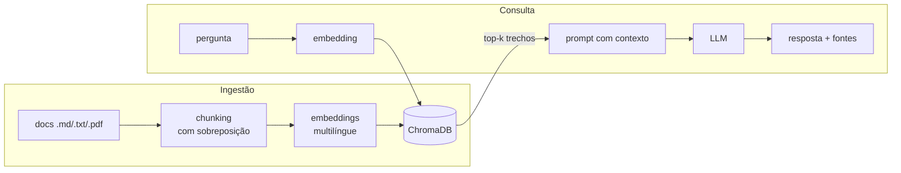

# 🤖 Assistente RAG para Documentos

Assistente que responde perguntas em linguagem natural sobre um conjunto de documentos (normas, manuais, atas), **sempre citando o trecho e o arquivo de origem**. Usa *Retrieval-Augmented Generation*: busca semântica num banco vetorial + geração com LLM.


## Arquitetura



**Decisões de projeto**
- Embeddings `paraphrase-multilingual-MiniLM-L12-v2` — bons em português e rodam em CPU.
- LLM via **API compatível com OpenAI**: funciona com OpenAI, Azure, Groq ou **Ollama local** (dados não saem da máquina — importante no setor público).
- O prompt obriga o modelo a responder **apenas com base no contexto** e a dizer "não encontrei" quando faltar informação (reduz alucinação).

## Como executar

```bash
pip install -r requirements.txt
cp .env.example .env                 # configure LLM_BASE_URL / LLM_MODEL / LLM_API_KEY

python src/ingest.py data/docs       # indexa os documentos
uvicorn app:app --reload             # API em http://localhost:8000/docs
```

Exemplo:

```bash
curl -X POST localhost:8000/perguntar -H "Content-Type: application/json" \
     -d '{"pergunta": "Qual o prazo de vigência de uma ata de registro de preço?"}'
```

```json
{
  "resposta": "A vigência é de até 1 ano, prorrogável por igual período... [1]",
  "fontes": [{"arquivo": "guia_registro_preco.md", "trecho": 2, "score": 0.81}]
}
```

Usando Ollama local: `LLM_BASE_URL=http://localhost:11434/v1`, `LLM_MODEL=llama3.1`, `LLM_API_KEY=ollama`.

## Testes

```bash
pytest -q   # testa chunking e montagem de prompt (não precisa de LLM)
```

## Próximos passos
- [ ] Reranking com cross-encoder
- [ ] Avaliação automática (RAGAS) com conjunto de perguntas-ouro
- [ ] Interface em Streamlit
- [ ] Orquestração da ingestão via n8n quando novos documentos chegarem

---
Autor: [Carlos Absalão](https://www.linkedin.com/in/carlos-absalao-dados-ia) · Licença MIT
